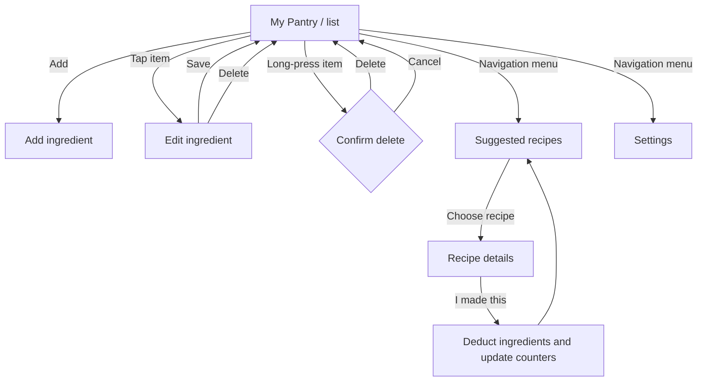
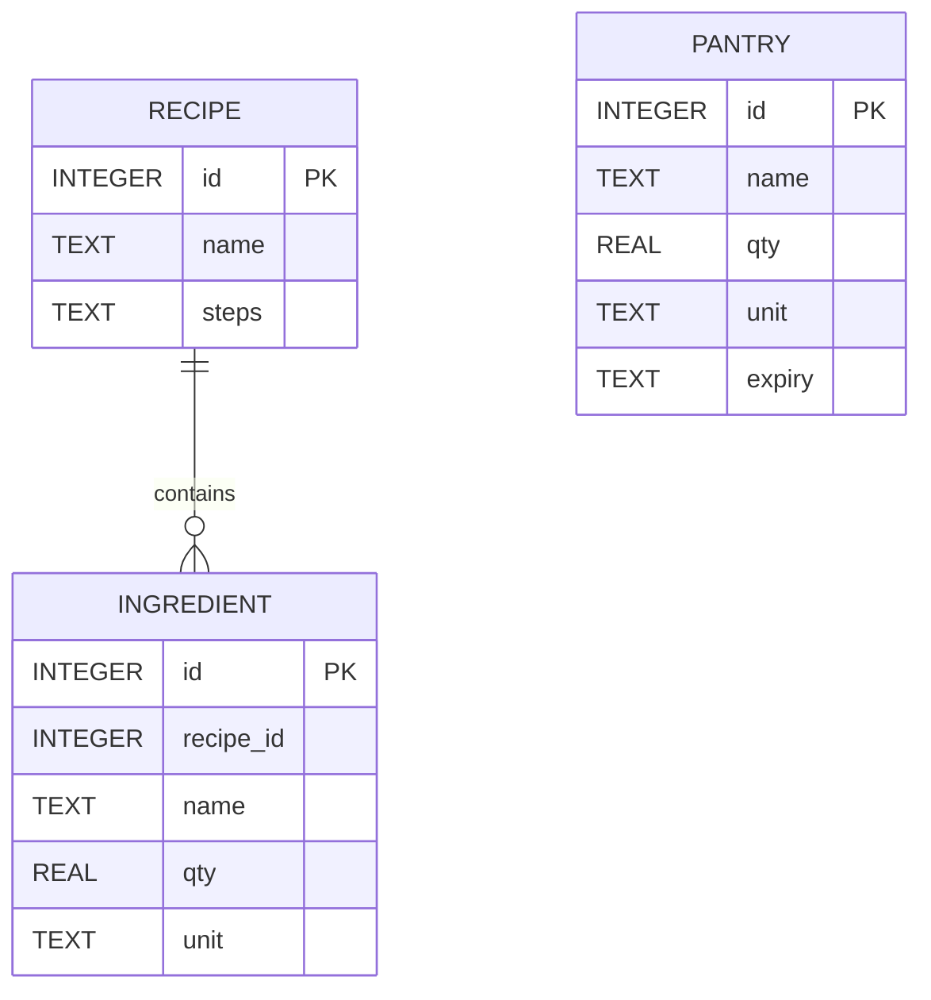
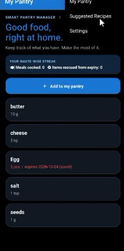
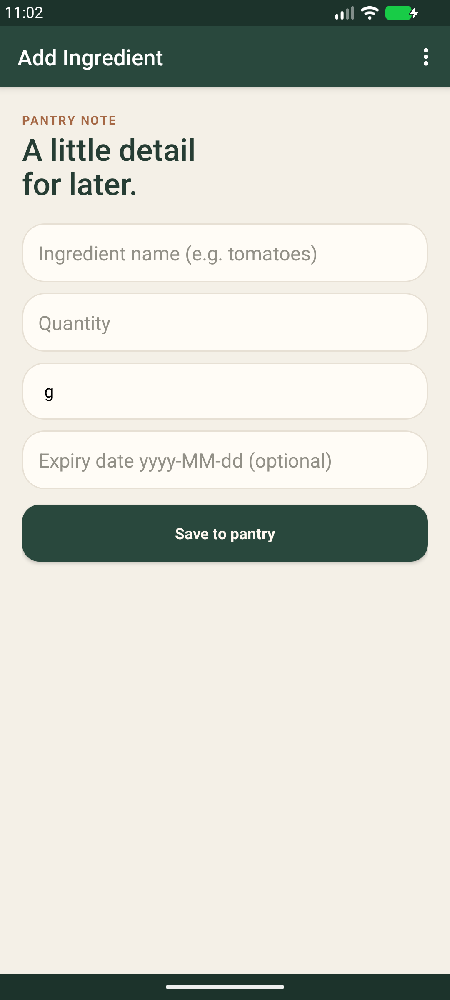
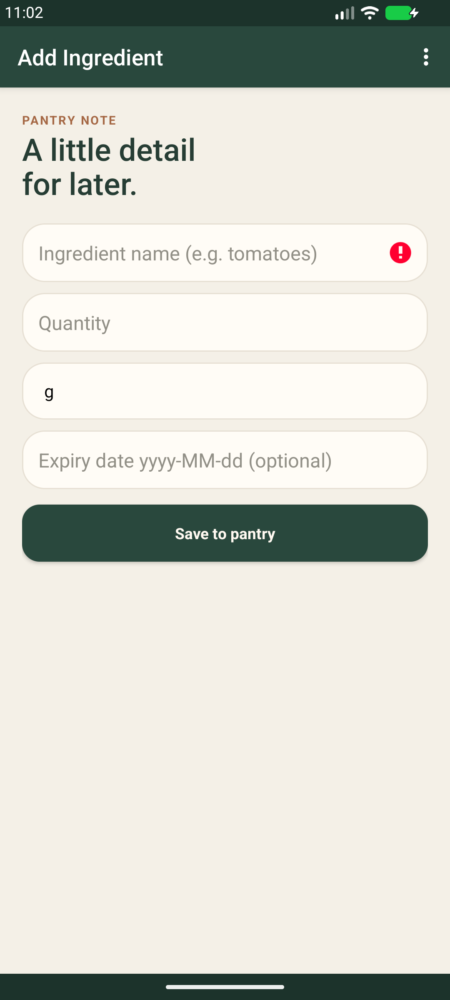
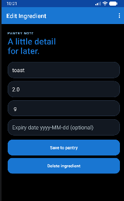
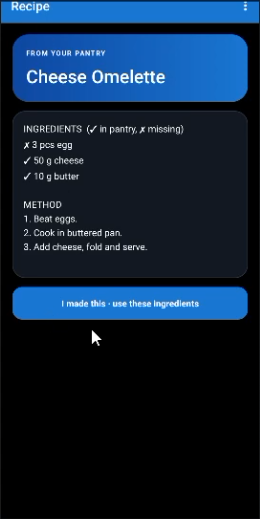
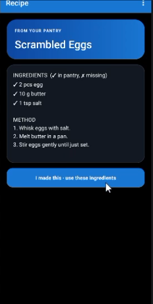

# Mobile App Development 700 — Practical Assignment

## Smart Pantry Manager

| | |
|---|---|
| **Student** | Kyle Khoza |
| **Student number** | 402306600 |
| **Module** | Mobile App Development 700 |
| **Date** | 23 October 2026 |
| **GitHub repository** | [Smart Pantry Manager](https://github.com/Shi-ki-is-gone/Smart-Pantry-Manager) |
| **Project video** | [Watch the project video](https://youtu.be/qcuU7NEnsEo) |

---

## Table of contents

1. [Introduction](#introduction)
2. [System design](#system-design)
   - [Screen flow](#screen-flow)
   - [Data model](#data-model)
3. [Screenshots and outputs](#screenshots-and-outputs)
4. [Key code snippets](#key-code-snippets)
5. [Conclusion](#conclusion)

## Introduction

Smart Pantry Manager helps people keep track of food they already have at home, use ingredients before they expire, and decide what to cook. It is intended for individuals and households who want a simple offline pantry list and practical recipe suggestions without needing a separate account or internet connection.

Users can record ingredients, quantities, units, and optional expiry dates; update or remove pantry entries; and browse recipes that match their stock. Recipes that use ingredients nearing expiry are prioritised. The app also offers recipes that are one ingredient short and updates pantry quantities when the user records that they cooked a recipe.

## System design

The Android application is written in Java. Activities provide the pantry, ingredient form, recipe suggestions, recipe details, and settings screens. A local SQLite database stores pantry and recipe data. Android `SharedPreferences` stores the expiry-alert setting and the cooked/rescued counters.

### Screen flow



### Data model

The app creates three SQLite tables. Pantry entries are independent records. A recipe has multiple ingredient rows, associated by `ingredient.recipe_id` with `recipe.id`.



`PANTRY` holds the user's stock and optional expiry dates. `RECIPE` stores recipe names and method steps; `INGREDIENT` stores each recipe's required ingredients and quantities. The settings switch and the two counters are stored separately in `SharedPreferences`, not in these tables. Recipe ingredient matching uses normalised names and compatible measurement units.

`ingredient.recipe_id` is the logical association to `recipe.id`; the current SQLite schema does not declare a SQL foreign-key constraint.

## Screenshots and outputs

The screenshots below are genuine screenshots already present in the project; no mockups or newly generated screen images are used. The `provided-*` images show the current dark-and-blue interface. The existing add, validation, edit, and delete captures show an earlier visual pass of the same flows. The app was not run to produce additional captures.

### Pantry list



*The pantry screen lists ingredients and quantities, highlights an item nearing expiry, and displays the meals-cooked and items-rescued counters.*

### Add ingredient



*The add form collects an ingredient name, quantity, unit, and optional expiry date.*

### Validation error



*A captured validation attempt on the ingredient form. The form prevents saving when required values are missing or invalid.*

### Edit ingredient



*The edit flow opens an existing pantry item with its values available for updating; the form also provides a delete action.*

### Delete confirmation


*The confirmation dialog gives the user a chance to cancel before an ingredient is removed.*

### Suggested recipes


*Recipes that can be made from pantry stock are shown separately from recipes that are missing one ingredient. The matching recipe uses an ingredient nearing expiry.*

### Recipe detail: Cheese Omelette



*The detail screen shows the ingredient checklist, cooking method, and the action to use the ingredients from the pantry.*

### Recipe detail: Scrambled Eggs



*A second recipe detail screen demonstrates the same ingredient and method presentation for a recipe fully covered by the pantry.*

**Screenshot coverage note:** No screenshot was available for the Settings screen or the post-cooking result. The recipe detail captures show the cooking action before it is selected. Those additional states are therefore not represented as screenshots.

## Key code snippets

### 1. Validate ingredient input before saving

From `EditItemActivity.save()`:

```java
if (name.isEmpty()) { etName.setError("Name is required"); return; }
if (qs.isEmpty()) { etQty.setError("Quantity is required"); return; }
double q;
try { q = Double.parseDouble(qs); }
catch (Exception e) { etQty.setError("Enter a valid number"); return; }
if (q <= 0) { etQty.setError("Quantity must be greater than 0"); return; }
```

Validation happens at the form boundary, before database writes. It gives the user field-specific feedback and prevents empty, non-numeric, or non-positive quantities from being saved.

### 2. Save pantry items as inserts or updates

From `Db.save()`:

```java
if (p.id == 0) {
    p.id = d.insertOrThrow("pantry", null, v);
} else if (d.update("pantry", v, "id=?", new String[]{String.valueOf(p.id)}) != 1) {
    throw new IllegalStateException("Pantry item no longer exists: " + p.id);
}
```

The item ID distinguishes a new pantry entry from an existing one. The update uses a parameterised ID condition, and an unexpected missing row is reported rather than silently treated as a successful edit.

### 3. Keep recipes with missing ingredients out of the makeable list

From `Matcher.suggest()`:

```java
for (Match m : evaluateAll(pantry, recipes)) {
    if (m.missing.isEmpty() && !m.recipe.ings.isEmpty()) out.add(m);
}
Collections.sort(out, (a, b) -> b.rescue != a.rescue
    ? b.rescue - a.rescue
    : a.recipe.name.compareTo(b.recipe.name));
```

Only recipes whose required ingredients are all available appear as makeable suggestions. Sorting by the rescue score puts recipes using more soon-to-expire ingredients first, with the recipe name as a stable tie-breaker.

### 4. Make cooking updates atomic

From `Db.cook()`:

```java
d.beginTransaction();
try {
    ...
    d.setTransactionSuccessful();
    return rescued;
} finally {
    d.endTransaction();
}
```

Cooking changes multiple pantry rows. A SQLite transaction ensures the stock deduction is committed as one operation; if processing fails before the transaction is marked successful, SQLite rolls the changes back.

## Conclusion

Smart Pantry Manager combines local pantry tracking with recipe matching and expiry-aware suggestions. Its core design keeps pantry data on-device, validates ingredient entries, and applies recipe consumption within a database transaction to help reduce avoidable food waste.
